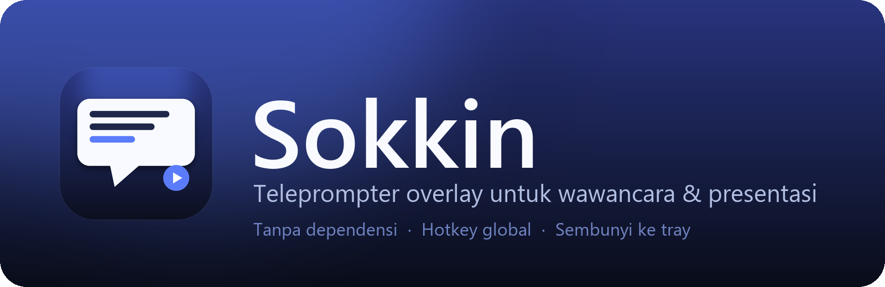
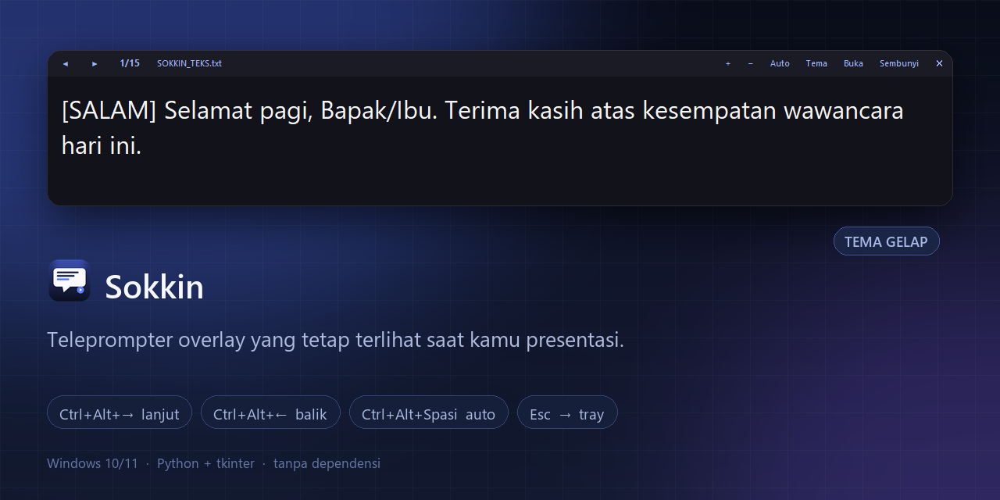
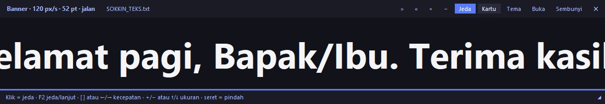

<p align="center">
  
</p>

<p align="center">
  
  
  
  
</p>

Overlay teleprompter **selalu-di-depan** untuk Windows — dirancang untuk wawancara online (Zoom/Meet/Teams) dan presentasi. Teks besar di paling atas layar, jadi kamu tetap melihat lawan bicara sambil membaca catatan.

- **Tanpa dependensi** — cukup Python 3.10+ dengan tkinter (sudah bawaan).
- **Hotkey global** — navigasi tetap jalan walau fokus di aplikasi lain (mis. Zoom).
- **Auto-play** — teks jalan sendiri dengan progress bar, kecepatan bisa diatur.
- **Mode banner** — teks berjalan kanan→kiri ala billboard; kecepatan & ukuran bisa diatur, klik untuk jeda.
- **Scope banner** — putar semua kartu sekaligus atau hanya kartu yang sedang aktif.
- **Sembunyi ke tray** — panel hilang ke system tray; klik ikonnya untuk memunculkan lagi.
- **Aman dipakai** — cegah dua instance, peringatan hotkey bentrok, bantuan `F1`, dan log error.
- **Ringan & portabel** — satu file `.py`, atau satu `Sokkin.exe` (±11 MB) tanpa perlu Python.

## Showcase

| Tema gelap | Tema sepia |
|---|---|
|  |  |

**Mode banner** — teks dari semua kartu berjalan terus seperti running text:



## Download

Ambil `Sokkin.exe` terbaru di **[Releases](https://github.com/kandarlubis31/Sokkin/releases/latest)** — tinggal unduh dan jalankan, tidak perlu install Python.

> Windows SmartScreen mungkin menampilkan peringatan karena exe belum ditandatangani. Klik **More info → Run anyway**.

## Fitur

| Fitur | Detail |
|---|---|
| Kartu per baris | Satu baris di file `.txt` = satu kartu; baris kosong & `#` diabaikan |
| Selalu di depan | Panel nempel di atas, bisa diseret & di-resize |
| Sembunyi-pintar | `Esc` / tombol Sembunyi / seret ke atas layar → **minimize ke system tray**; klik ikon tray, `Ctrl+Alt+H`, atau hover tepi atas → tampil lagi |
| Hotkey global | `Ctrl+Alt+→/←` kartu (atau kecepatan di mode banner), `Ctrl+Alt+Spasi` auto/jeda, `Ctrl+Alt+B` ganti mode, `Ctrl+Alt+H` sembunyi/tampil, `Ctrl+Alt+Q` keluar |
| Auto-play | Progress bar + interval 2–60 detik, putar otomatis dari awal |
| Mode banner | Semua kartu digabung jadi running text kanan→kiri, loop mulus tanpa jeda; kecepatan 20–600 px/detik, ukuran font sendiri, klik = jeda |
| Scope banner | Tombol **Semua / Kartu ini** — putar seluruh deck atau ulangi satu kartu aktif saja |
| Bantuan & tray | `F1` membuka daftar kontrol; menu tray bisa ganti mode, jeda banner, scope, topmost, dan keluar |
| Satu instance | Membuka exe dua kali tidak membuat tray/hotkey ganda — instance kedua memberi pesan lalu keluar |
| Peringatan hotkey | Kalau `Ctrl+Alt+…` sudah dipakai aplikasi/driver lain, Sokkin memberi tahu kombinasi mana yang gagal |
| Log error | Traceback disimpan di `%APPDATA%\sokkin\sokkin.log` untuk troubleshooting |
| 3 tema | Gelap, terang, sepia |
| Anti-nyasar | Panel tidak bisa diletakkan keluar layar; saat dimunculkan lagi selalu kembali ke area terlihat |
| Kenang pengaturan | Posisi, ukuran, font, transparansi, file terakhir — tersimpan antar sesi |

## Cara pakai

```bash
# jalankan dengan file kartu
python src/sokkin/app.py SOKKIN_TEKS.txt

# atau langsung (otomatis cari SOKKIN_TEKS.txt di folder project)
python src/sokkin/app.py

# atau sebagai module (dari folder src/)
python -m sokkin
```

### Kontrol

| Aksi | Tombol |
|---|---|
| Kartu berikutnya | `Spasi` · `→` · `↓` · `PageDown` · klik kiri teks · klik kanan sebelumnya |
| Kartu sebelumnya | `←` · `↑` · `PageUp` |
| Kartu pertama / terakhir | `Home` / `End` |
| Ganti mode kartu ↔ banner | `F3` · tombol **Banner** / **Kartu** |
| Banner: jeda / lanjut | `F2` · `Spasi` · klik area banner |
| Banner: kecepatan | `[` / `]` · `←` / `→` · tombol `«` `»` |
| Banner: ukuran teks | `+` / `−` · `↑` / `↓` · `Ctrl`+scroll |
| Banner: scope semua / kartu ini | tombol **Semua** / **Kartu ini** · menu tray |
| Banner: ganti kartu saat scope "kartu ini" | `PageUp` / `PageDown` |
| Bantuan lengkap | `F1` · tombol `?` · menu tray → Bantuan |
| Seret panel | klik-tahan bar atas / area teks / area banner, seret kemana saja |
| Sembunyikan panel | `Esc` · tombol **Sembunyi** · seret panel ke atas melewati tepi layar → ke system tray |
| Munculkan lagi | **klik ikon tray** (klik kanan = menu) · `Ctrl+Alt+H` · hover tepi atas layar |
| Perbesar / perkecil teks | `+` / `-` · `Ctrl`+scroll |
| Auto-play on/off | `F2` |
| Interval auto (lebih lambat/cepat) | `[` / `]` |
| Ganti tema | `Ctrl+T` |
| Transparansi | `Ctrl+↑` / `Ctrl+↓` |
| Selalu di depan on/off | `F10` |
| Buka file kartu | `Ctrl+O` |
| Keluar | `Ctrl+Q` |

Hotkey **global** (berfungsi walau fokus di Zoom): `Ctrl+Alt+→` · `Ctrl+Alt+←` · `Ctrl+Alt+Spasi` · `Ctrl+Alt+B` · `Ctrl+Alt+H` · `Ctrl+Alt+Q`.

> Ikon tray kadang masuk ke area overflow Windows. Klik panah **`^`** di taskbar untuk melihatnya.

## Tips & troubleshooting

- **Hotkey global tidak jalan?** Sokkin hanya bisa jalan satu instance. Beberapa aplikasi/driver (terutama driver grafis untuk `Ctrl+Alt+←/→`) bisa merebut kombinasi tersebut; Sokkin akan menampilkan peringatan kombinasi mana yang gagal. Tutup aplikasi/driver itu lalu jalankan ulang Sokkin.
- **Panel terasa hilang?** Klik ikon Sokkin di tray, atau tekan `Ctrl+Alt+H`. Panel selalu dikembalikan ke area layar yang terlihat.
- **Aplikasi tidak muncul / error?** Cek `%APPDATA%\sokkin\sokkin.log` — traceback terakhir disimpan di sana.
- **Kartu tidak muncul?** File harus berisi satu baris per kartu. Baris kosong dan baris berawalan `#` diabaikan.
- **Peringatan SmartScreen?** Exe belum ditandatangani; klik **More info → Run anyway**.

## Format file kartu

```text
# komentar — diabaikan
[SALAM] Selamat pagi, Bapak/Ibu. Terima kasih atas waktunya.
[PENGENALAN] Saya [Nama Lengkap], lulusan S1 [Jurusan] ...

[LANJUTAN] Kartu berikutnya mulai di baris baru.
```

Deck contoh di repo sengaja generik — ganti bagian dalam `[kurung siku]` dengan ceritamu sendiri.

## Build `.exe` (Windows)

```bash
pip install pyinstaller
build.bat
```

Hasilnya ada di `dist/Sokkin.exe` — satu file, sudah membawa logo, contoh kartu, dan bisa dibagikan tanpa perlu Python.

## Struktur project

```text
Sokkin/
├── src/sokkin/
│   ├── app.py              # seluruh aplikasi (tkinter + stdlib)
│   ├── assets/             # logo, ikon .ico multi-size, ikon tray
│   ├── __init__.py
│   └── __main__.py         # python -m sokkin
├── showcase/               # banner, logo, screenshot README
├── tools/make_brand.py     # regenerasi aset brand (butuh Pillow, dev-only)
├── SOKKIN_TEKS.txt         # dek contoh 15 kartu (satu baris = satu kartu)
├── build.bat               # build dist/Sokkin.exe via PyInstaller
├── pyproject.toml
├── CONTEXT.md              # ringkasan arsitektur & status untuk sesi berikutnya
└── PLAN.md                 # catatan pengembangan
```

## Pengaturan

Disimpan di `%APPDATA%\sokkin\settings.json`. Hapus file itu untuk kembali ke pengaturan awal. Yang diingat antara lain: posisi & ukuran panel, tema, font, transparansi, file terakhir, mode terakhir, kecepatan banner, ukuran font banner, dan scope banner (semua kartu / kartu ini).

Log error ada di `%APPDATA%\sokkin\sokkin.log`.

## Lisensi

MIT — lihat [LICENSE](LICENSE). Dibuat oleh **Aulia Iskandar Lubis**.
