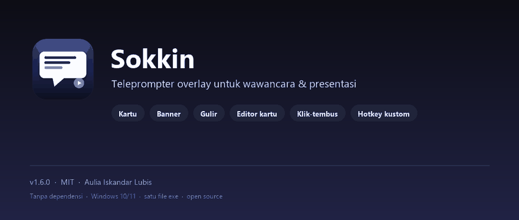
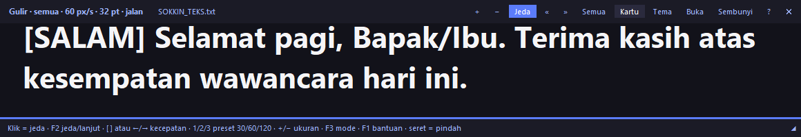

<p align="center">
  
</p>

<p align="center">
  
  
  
  
</p>

Overlay teleprompter **selalu-di-depan** untuk Windows — dirancang untuk wawancara online (Zoom/Meet/Teams) dan presentasi. Teks besar di paling atas layar, jadi kamu tetap melihat lawan bicara sambil membaca catatan.

- **Tanpa dependensi** — cukup Python 3.10+ dengan tkinter (sudah bawaan).
- **Tiga mode** — kartu per baris, banner kanan→kiri, dan gulir vertikal ala teleprompter.
- **Hotkey global** — navigasi tetap jalan walau fokus di aplikasi lain (mis. Zoom), dan kombinasinya bisa direkam ulang.
- **Editor kartu bawaan** — tambah, urutkan, edit, tempel dari clipboard, lalu simpan tanpa keluar aplikasi.
- **Klik-tembus** — panel tidak menghalangi klik ke Zoom atau aplikasi di belakangnya.
- **Ringan & portabel** — satu file `.py`, atau satu `Sokkin.exe` (±11 MB) tanpa perlu Python.

## Demo



## Showcase

| Tema gelap | Tema sepia |
|---|---|
|  |  |

**Mode banner** — teks dari semua kartu (atau satu kartu aktif) berjalan terus seperti running text:


**Mode gulir** — teks bergerak vertikal seperti teleprompter klasik:



## Download

Ambil `Sokkin.exe` terbaru di **[Releases](https://github.com/kandarlubis31/Sokkin/releases/latest)** — tinggal unduh dan jalankan, tidak perlu install Python.

SHA-256 rilis **v1.6.0**:

```text
ba192ec057971ab9e748175766fdf142e03d161e3b4642cde84fb58848472aff
```

Cara mencocokkan: buka PowerShell di folder unduhan, lalu jalankan

```powershell
Get-FileHash .\Sokkin.exe -Algorithm SHA256
```

> Windows SmartScreen mungkin menampilkan **“Windows protected your PC”** karena exe belum ditandatangani digital. Itu peringatan reputasi file baru, bukan deteksi virus — penjelasan lengkap ada di [Kenapa Windows memberi peringatan?](#kenapa-windows-memberi-peringatan).

## Fitur

| Fitur | Detail |
|---|---|
| Kartu per baris | Satu baris di file `.txt` = satu kartu; baris kosong & `#` diabaikan |
| Selalu di depan | Panel nempel di atas, bisa diseret & di-resize |
| Sembunyi-pintar | `Esc` / tombol Sembunyi / seret ke atas layar → **minimize ke system tray**; klik ikon tray, `Ctrl+Alt+H`, atau hover tepi atas → tampil lagi |
| Tiga mode | Kartu → Banner → Gulir vertikal; `F3`, `Ctrl+Alt+B`, tombol mode, atau menu tray |
| Mode banner | Semua kartu digabung jadi running text kanan→kiri, loop mulus tanpa jeda; kecepatan 20–600 px/detik, ukuran font sendiri, klik = jeda |
| Mode gulir | Teks naik vertikal seperti teleprompter; kecepatan 10–300 px/detik, ukuran font sendiri, loop mulus |
| Preset kecepatan | Tombol `1` / `2` / `3` — banner 60/120/240, gulir 30/60/120 px/detik |
| Scope teks berjalan | Tombol **Semua / Kartu ini** — putar seluruh deck atau ulangi satu kartu aktif saja |
| Editor kartu | `Ctrl+E` — daftar kartu, tambah/hapus/naik-turun, edit isi, tempel clipboard, simpan / simpan sebagai, muat ulang, lompat ke panel |
| Auto-reload | File `.txt` yang diedit di luar aplikasi otomatis dimuat ulang dalam ±1,2 detik; `F5` untuk manual, posisi kartu dipertahankan |
| Klik-tembus | `Ctrl+Alt+X` — panel tetap terlihat, tetapi klik & scroll diteruskan ke aplikasi di belakangnya |
| Hotkey kustom | Semua 7 aksi global bisa direkam ulang di **Pengaturan → Hotkey**; kalau bentrok, Sokkin otomatis memakai kombinasi default dan memberi tahu |
| Pengaturan lengkap | `Ctrl+,` — tab Tampilan, Gerak, Hotkey, serta Info & keamanan; perubahan langsung diterapkan |
| Panduan pertama | Saat pertama dibuka, Sokkin menampilkan panduan singkat + penjelasan peringatan Windows |
| Autosave | Perubahan pengaturan disimpan otomatis (debounce 500 ms) dengan penulisan atomik; tidak korup saat crash |
| Auto-play | Progress bar + interval 2–60 detik, putar otomatis dari awal |
| Bantuan & tray | `F1` membuka daftar kontrol; menu tray lengkap: mode, jeda, scope, klik-tembus, topmost, editor, pengaturan, log, reset posisi, keamanan, keluar |
| Satu instance | Membuka exe dua kali tidak membuat tray/hotkey ganda — instance kedua memberi pesan lalu keluar |
| Log error | Traceback disimpan di `%APPDATA%\sokkin\sokkin.log` untuk troubleshooting |
| 3 tema | Gelap, terang, sepia |
| Anti-nyasar | Panel tidak bisa diletakkan keluar layar; saat dimunculkan lagi selalu kembali ke area terlihat |
| Kenang pengaturan | Posisi, ukuran, font, transparansi, mode, kecepatan, hotkey, file terakhir — tersimpan antar sesi |

## Cara pakai

```bash
# jalankan dengan file kartu
python src/sokkin/app.py SOKKIN_TEKS.txt

# atau langsung (otomatis cari SOKKIN_TEKS.txt di folder project)
python src/sokkin/app.py

# atau sebagai module (dari folder src/)
python -m sokkin
```

### Kontrol

| Aksi | Tombol |
|---|---|
| Kartu berikutnya | `Spasi` · `→` · `↓` · `PageDown` · klik kiri teks · klik kanan sebelumnya |
| Kartu sebelumnya | `←` · `↑` · `PageUp` |
| Kartu pertama / terakhir | `Home` / `End` |
| Ganti mode kartu → banner → gulir | `F3` · tombol mode · menu tray |
| Teks berjalan: jeda / lanjut | `F2` · `Spasi` · klik area teks |
| Teks berjalan: kecepatan | `[` / `]` · `←` / `→` · tombol `«` `»` |
| Teks berjalan: preset kecepatan | `1` / `2` / `3` |
| Teks berjalan: ukuran teks | `+` / `−` · `↑` / `↓` · `Ctrl`+scroll |
| Teks berjalan: scope semua / kartu ini | tombol **Semua** / **Kartu ini** · menu tray |
| Teks berjalan: ganti kartu saat scope "kartu ini" | `PageUp` / `PageDown` |
| Editor kartu | `Ctrl+E` · menu tray |
| Pengaturan lengkap | `Ctrl+,` |
| Muat ulang file kartu | `F5` · menu tray |
| Bantuan lengkap | `F1` · tombol `?` · menu tray |
| Seret panel | klik-tahan bar atas / area teks / area teks berjalan, seret kemana saja |
| Sembunyikan panel | `Esc` · tombol **Sembunyi** · seret panel ke atas melewati tepi layar → ke system tray |
| Munculkan lagi | **klik ikon tray** (klik kanan = menu) · `Ctrl+Alt+H` · hover tepi atas layar |
| Perbesar / perkecil teks | `+` / `-` · `Ctrl`+scroll |
| Auto-play on/off (mode kartu) | `F2` |
| Interval auto (lebih lambat/cepat) | `[` / `]` |
| Ganti tema | `Ctrl+T` |
| Transparansi | `Ctrl+↑` / `Ctrl+↓` |
| Selalu di depan on/off | `F10` |
| Buka file kartu | `Ctrl+O` |
| Klik-tembus on/off | `Ctrl+Alt+X` · menu tray · Pengaturan → Info |
| Keluar | `Ctrl+Q` · `Ctrl+Alt+Q` |

Hotkey **global** (berfungsi walau fokus di Zoom): `Ctrl+Alt+→` · `Ctrl+Alt+←` · `Ctrl+Alt+Spasi` · `Ctrl+Alt+B` · `Ctrl+Alt+H` · `Ctrl+Alt+X` · `Ctrl+Alt+Q`. Semua bisa diubah di **Pengaturan → Hotkey**.

> Ikon tray kadang masuk ke area overflow Windows. Klik panah **`^`** di taskbar untuk melihatnya.

## Kenapa Windows memberi peringatan?

`Sokkin.exe` belum ditandatangani dengan sertifikat *code signing*. Windows SmartScreen memberi peringatan untuk aplikasi baru yang belum punya reputasi — ini **peringatan reputasi, bukan deteksi virus**. Banyak aplikasi open source kecil mengalami hal yang sama.

Kenapa belum ditandatangani:

- Sertifikat OV berbayar (ratusan ribu rupiah sampai jutaan per tahun) dan tetap perlu waktu untuk membangun reputasi.
- Sertifikat EV **tidak lagi** otomatis menghilangkan SmartScreen sejak 2024.
- Microsoft Store adalah satu-satunya jalur yang dijamin tanpa peringatan; Sokkin belum didistribusikan di sana.

Yang bisa kamu lakukan kalau ragu:

1. **Cocokkan SHA-256** file dengan nilai di halaman rilis (perintahnya ada di bagian [Download](#download)).
2. **Build sendiri dari sumber** — seluruh kode ada di repo ini; jalankan `build.bat`.
3. Jalankan lewat **More info → Run anyway** hanya kalau kamu percaya sumber unduhannya.

Sokkin open source, tidak butuh administrator, tidak mengirim data ke internet, dan hanya membaca file `.txt` yang kamu pilih. **Jangan mematikan Windows Defender hanya untuk menjalankan aplikasi ini.** Kalau Windows Defender benar-benar menandai file ini sebagai ancaman (bukan sekadar SmartScreen), jangan dijalankan — laporkan lewat Issues.

## Tips & troubleshooting

- **Hotkey global tidak jalan?** Sokkin hanya bisa jalan satu instance. Beberapa aplikasi/driver (terutama driver grafis untuk `Ctrl+Alt+←/→`) bisa merebut kombinasi tersebut; Sokkin menampilkan peringatan kombinasi mana yang gagal, lalu memakai kombinasi default kalau kustommu bentrok. Ubah kombinasinya di **Pengaturan → Hotkey**.
- **Panel terasa hilang?** Klik ikon Sokkin di tray, atau tekan `Ctrl+Alt+H`. Panel selalu dikembalikan ke area layar yang terlihat. Kalau posisinya aneh setelah monitor dicabut, pakai **menu tray → Reset posisi panel**.
- **Klik tidak sampai ke Zoom?** Matikan klik-tembus dengan `Ctrl+Alt+X` atau menu tray.
- **Aplikasi tidak muncul / error?** Cek `%APPDATA%\sokkin\sokkin.log` — traceback terakhir disimpan di sana. Menu tray → **Buka file log**.
- **Kartu tidak muncul?** File harus berisi satu baris per kartu. Baris kosong dan baris berawalan `#` diabaikan.
- **Peringatan SmartScreen?** Lihat [Kenapa Windows memberi peringatan?](#kenapa-windows-memberi-peringatan).

## Format file kartu

```text
# komentar — diabaikan
[SALAM] Selamat pagi, Bapak/Ibu. Terima kasih atas waktunya.
[PENGENALAN] Saya [Nama Lengkap], lulusan S1 [Jurusan] ...

[LANJUTAN] Kartu berikutnya mulai di baris baru.
```

Deck contoh di repo sengaja generik — ganti bagian dalam `[kurung siku]` dengan ceritamu sendiri. Editor bawaan (`Ctrl+E`) bisa menyimpan kembali ke file yang sama atau **Simpan sebagai...** ke file baru.

## Build `.exe` (Windows)

```bash
pip install pyinstaller
build.bat
```

Hasilnya ada di `dist/Sokkin.exe` — satu file, sudah membawa logo, metadata versi, manifest `asInvoker`, contoh kartu, dan bisa dibagikan tanpa perlu Python. Build memakai `--noupx` supaya tidak memicu false positive dari kompresi UPX.

## Struktur project

```text
Sokkin/
├── src/sokkin/
│   ├── app.py              # seluruh aplikasi (tkinter + stdlib)
│   ├── assets/             # logo, ikon .ico multi-size, ikon tray
│   ├── __init__.py
│   └── __main__.py         # python -m sokkin
├── showcase/               # banner, logo, screenshot, GIF demo
├── tools/make_brand.py     # regenerasi aset brand (butuh Pillow, dev-only)
├── SOKKIN_TEKS.txt         # dek contoh 15 kartu (satu baris = satu kartu)
├── build.bat               # build dist/Sokkin.exe via PyInstaller
├── version_info.txt        # metadata versi exe (Windows resource)
├── sokkin.manifest         # manifest asInvoker + long path
├── pyproject.toml
├── CONTEXT.md              # ringkasan arsitektur & status untuk sesi berikutnya
└── PLAN.md                 # catatan pengembangan
```

## Pengaturan

Disimpan di `%APPDATA%\sokkin\settings.json` dan ditulis secara atomik (`.tmp` + rename) supaya tidak korup. Hapus file itu untuk kembali ke pengaturan awal. Yang diingat antara lain: posisi & ukuran panel, tema, font, transparansi, interval auto, file terakhir, mode terakhir, kecepatan & ukuran banner/gulir, scope teks berjalan, hotkey kustom, dan status panduan pertama.

Log error ada di `%APPDATA%\sokkin\sokkin.log`.

## Lisensi

MIT — lihat [LICENSE](LICENSE). Dibuat oleh **Aulia Iskandar Lubis**.
